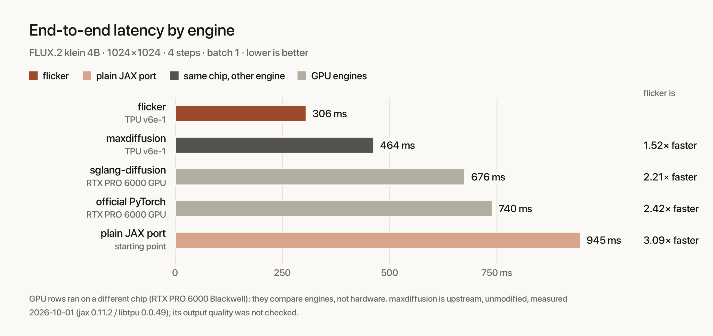
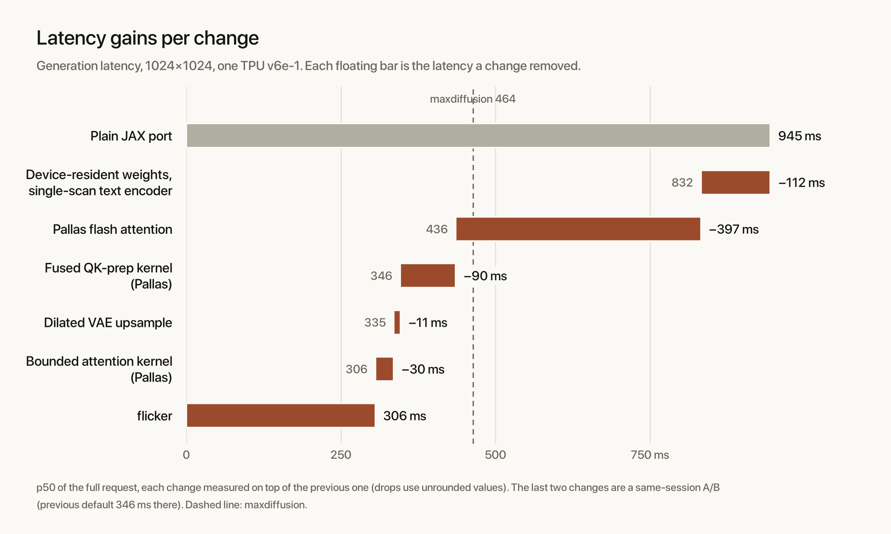
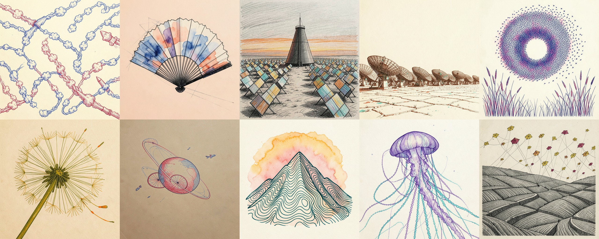

# flicker
flicker is a custom inference runtime for [Flux.2[Klein]-4b](https://huggingface.co/black-forest-labs/FLUX.2-klein-4B) on a single TPU v6e chip, using JAX/Pallas kernels. 306 ms per 1024² image generated. [**technical article**](https://kelechi.cc/articles/flicker) available here.

All development for this engine was done on tpu v6e (single chip, Google Colab). It remains untested on newer TPU variants (TPU7x/Ironwood); it doesn't fit on a v5e.

```
prompt ──► Qwen3-4B encoder (27 of 36 layers) ──► ctx ──┐
                                                        ▼
            noise ──► 4-step Euler (DiT) ──► latent ──► VAE decoder ──► image
```

## results

1024², batch 1, 4 denoise steps, bf16, one TPU v6e-1 (Colab), p50 of 20 warm requests:

| engine | device | 1024² | 512² |
|---|---|---|---|
| **flicker** | TPU v6e-1 | **306 ms** (3.27 img/s) | **91.5 ms** |
| maxdiffusion (JAX) | TPU v6e-1 | 463.5 ms | 112.2 ms |
| sglang-diffusion | RTX Pro 6000 | 675.6 ms | — |
| official PyTorch | RTX Pro 6000 | 739.7 ms | — |
| plain JAX port (start) | TPU v6e-1 | 944.7 ms | — |



Stage split (text / DiT / VAE): 105 / 809 / 43 ms for the plain JAX port, and 7 / 270 / 26 ms now. MFU rose from 17.6% to 54.5% of the v6e bf16 peak (918 TFLOP/s).

## what changed

- **text encoder (105 → 7 ms):** weights moved to the device once, and one `lax.scan` over 27 layers
  taps hidden states 9/18/27.
- **flash attention (DiT 784 → 388 ms):** 2304 tiles instead of naive SDPA.
- **fused qk-prep (`kernels.qk_prep`):** head transpose, QK-RMSNorm and RoPE in one Pallas pass,
  114 → 12 ms.
- **bounded attention (`kernels.attend`):** flash without the running max, legal because QK-norm
  bounds the logits (checked at load); 380 TFLOP/s against a 391 ceiling at head_dim 128.
- **dilated upsample (VAE 37 → 26 ms):** nearest-2x + 3x3 conv as one 4x4 conv.



## sample outputs


## usage

**Requirements:** 
- TPU v6e (that's where flicker was tested/developed. you can use Colab provisioned ones). The Pallas kernels (flash attention, fused q/k prep) run on TPU only; every other backend takes
the plain XLA path.
- any other GPU with 32gb of VRAM/HBM (or more). 1024x1024 generation peaks around 23gb.

Weights are from `black-forest-labs/FLUX.2-klein-4B`([huggingface repo](https://huggingface.co/black-forest-labs/FLUX.2-klein-4B/tree/main)); the paths below are relative to that snapshot's root.

```python
from flicker.config import Config
from flicker.pipeline import Paths, generate_resident, load_all

cfg = Config()
paths = Paths(
    dit="flux-2-klein-4b.safetensors",
    text_index="text_encoder/model.safetensors.index.json",
    vae="vae/diffusion_pytorch_model.safetensors",
)

weights = load_all(paths, cfg)  # ~13 GB on device: needs a 32 GB accelerator
image = generate_resident(weights, cfg, "a misty forest at dawn", height=1024, width=1024)
# image: (1024, 1024, 3) uint8
```

## tools

```bash
uv run python tools/generate.py "ink doodle of jellyfish in coral reefs" --size 1024 --grid 1   # images + prompts.json in out/images
uv run python tools/bench.py --reps 20 [--size 512] [--trace out/trace]   # p50 text / dit / vae / request, json out.
uv run python tools/score.py REFERENCE_DIR CANDIDATE_DIR     # lpips + dinov2 over same-named pngs
```

`tools/score.py` needs torch, pyiqa and transformers; the rest need only flicker's dependencies.

## acknowledgements
- claude opus 5.5 + deepseek v4.1-flash for being crucial with research + implementations.
- Black Forest Labs for the open-weights image generation model releases.
- Modal for the free GPU credits, and Google Colab for reliable Tpu v6e-1 provisioning.

## license

Apache-2.0 — see [`LICENSE`](LICENSE).
